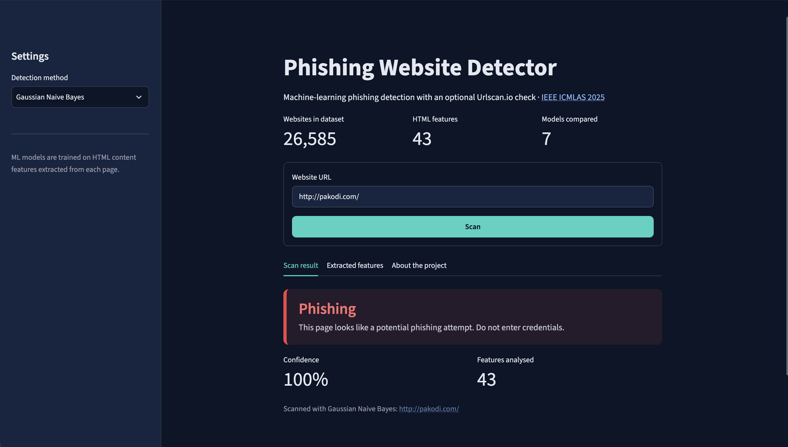
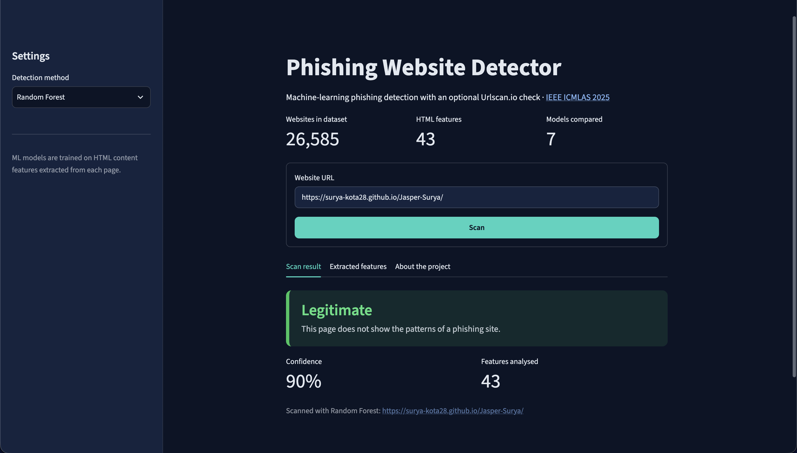
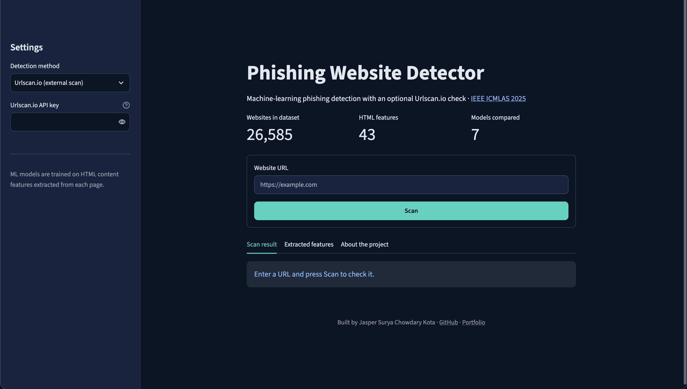

# Phishing Website Detector

A Streamlit web app that classifies websites as legitimate or phishing using machine learning on HTML content features, with an optional second opinion from the Urlscan.io API.

This was my B.Tech major project, published in the proceedings of the IEEE International Conference on Machine Learning and Autonomous Systems (ICMLAS 2025). [Read the paper on IEEE Xplore](https://ieeexplore.ieee.org/document/10967695).



## How it works

1. **Fetch:** the app downloads the page at the URL you enter.
2. **Extract:** BeautifulSoup parses the HTML and turns it into a vector of 43 structural features, such as forms, password and hidden inputs, iframes, links, scripts and meta tags.
3. **Classify:** the model you pick predicts whether the page is legitimate or phishing, and shows its confidence where the model supports it.
4. **Optional external check:** the Urlscan.io option submits the URL to Urlscan.io and reports its verdict and categories.

## Features

- Seven classifiers to compare: Random Forest, AdaBoost, Decision Tree, Neural Network (MLP), K-Nearest Neighbors, Support Vector Machine and Gaussian Naive Bayes
- Clear verdict card (green for legitimate, red for phishing) with model confidence
- **Extracted features** tab showing all 43 values the model used for a scan
- Urlscan.io integration as an independent, reputation-based check

| Legitimate result | Urlscan.io option |
|---|---|
|  |  |

## Model performance

Accuracy on a held-out 20% of the unique samples (3,013 websites the models never saw during training):

| Model | Accuracy |
|---|---|
| Random Forest | 98.3% |
| AdaBoost | 98.0% |
| Support Vector Machine | 97.9% |
| Decision Tree | 97.9% |
| K-Nearest Neighbors | 97.9% |
| Neural Network (MLP) | 93.5% |
| Gaussian Naive Bayes | 53.2% |

Tree-based models perform best on these structural features. Gaussian Naive Bayes is kept as a baseline: its assumption that features are independent doesn't hold for HTML structure (for example, pages with more inputs also tend to have more forms and buttons). Results can vary slightly between runs because the data is shuffled before splitting.

## Dataset

26,585 websites collected in October 2022:

| Class | Source | Websites |
|---|---|---|
| Legitimate | [Tranco list](https://tranco-list.eu/) | 16,061 |
| Phishing | [PhishTank](https://phishtank.org/) | 10,524 |

Each page was scraped and converted into the same 43 HTML features the app extracts at scan time. The structured datasets (`structured_data_legitimate.csv`, `structured_data_phishing.csv`) are included in this repo. Label 1 means phishing and 0 means legitimate.

Many pages produce identical feature vectors, so duplicates are removed before training, leaving 15,053 unique samples.

The raw URL lists used to build the dataset (`tranco_list.csv` and `verified_online.csv`) are too large for GitHub. They're only needed to rebuild the dataset with `data_collector.py`, not to run the app. They're in the original project archive on [Google Drive](https://drive.google.com/file/d/1N1wHVOclzm2i1f2kdcHUbuS42xSW2g9S/view?usp=sharing) (`code.zip`, about 196 MB).

## Run it locally

Requires Python 3.11 or later.

```bash
git clone https://github.com/Surya-kota28/B.Tech-Project.git
cd B.Tech-Project
python3 -m venv venv
source venv/bin/activate        # Windows: venv\Scripts\activate
pip install -r requirements.txt
streamlit run test.py
```

Then open http://localhost:8501.

The models train when the app starts, so the first load takes about 5 seconds. A loading message shows while this happens.

**Urlscan.io option:** this needs your own API key. Create a free account at [urlscan.io](https://urlscan.io/user/signup) and copy your key from your profile settings. The key is used only for the request you make and isn't stored.

## Project structure

| File | Purpose |
|---|---|
| `test.py` | Streamlit app (UI, scanning, Urlscan.io integration) |
| `machine_learning.py` | Loads the dataset and trains the seven classifiers |
| `feature_extraction.py` | Builds the 43-feature vector from a parsed page |
| `features.py` | Individual HTML feature functions |
| `data_collector.py` | Scrapes URL lists into the structured datasets |
| `graphs.py` | Model evaluation plots (confusion matrix, ROC, precision-recall) |
| `Project-manual.pdf` | Original project manual |
| `ICMLAS-PAPER.pdf` | Published conference paper |

## Limitations

- The app can only scan pages it can reach. Sites that block automated requests, or phishing pages that have already been taken down, return an error instead of a verdict.
- The training data dates from October 2022, so newer phishing techniques may be missed.
- The models look only at HTML structure, not at the URL text, domain age or hosting reputation. The Urlscan.io option helps cover those.
- Support Vector Machine doesn't produce a probability, so its confidence shows as "n/a".

## Author

**Jasper Surya Chowdary Kota** · [GitHub](https://github.com/Surya-kota28) · [Portfolio](https://surya-kota28.github.io/Jasper-Surya)

I designed and built the application and the machine learning pipeline. The paper was co-authored with Sri Devi Sameera Mekhala, Meghana Koppula, Jasti Nithin Ranganayakulu and Chittabathina Venkata Sai Poojitha, who contributed to the documentation and dataset gathering.
